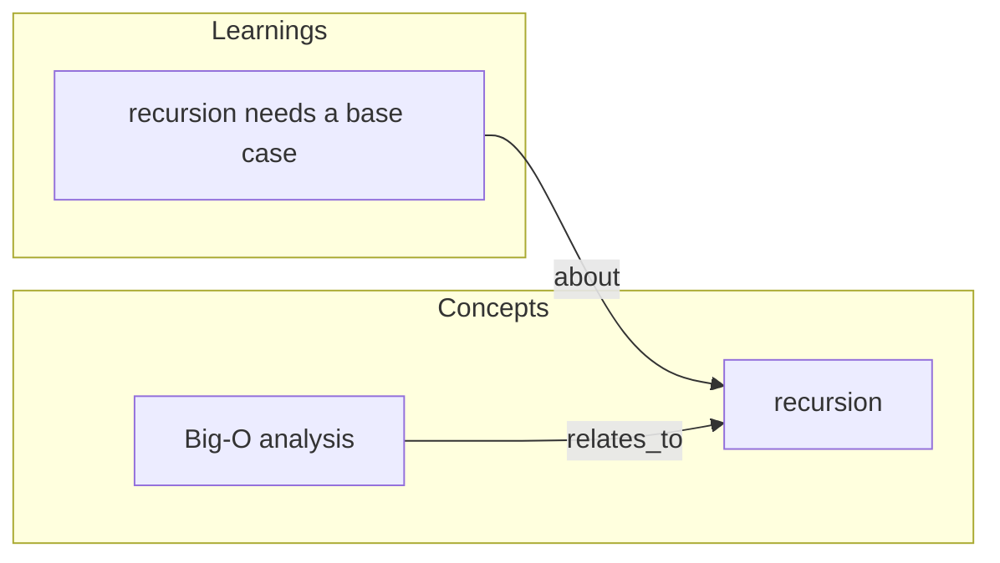

# Graphify Rendering Reference

## Reading the graph

The graph is an operation log. Do not parse it by hand; ask the script for current state.

```sh
python3 harness/scripts/ontology.py list                          # every entity
python3 harness/scripts/ontology.py list --type Concept           # one type
python3 harness/scripts/ontology.py related --id env:my-env --dir incoming   # edges into a node
```

Entities have `id`, `type`, `properties`. Edges come from `related` (`relation`, `direction`, `entity`). Count nodes per type from the `list` output before choosing a format. `harness/memory/schema.toml` (plus the local overlay) is the authoritative list of types and relations.

## Mermaid template (markdown output)

````markdown
# Knowledge Graph — YYYY-MM-DD
Shown: 34/87 nodes · types: Concept, Learning · 41 edges


````

Mermaid ids cannot contain `:` or `-`: replace them with `_`. Label with the node's `name` (or `summary`), truncated to about 30 characters.

## Standalone HTML (large graphs)

Write a single HTML file that embeds the Mermaid source in a `<pre class="mermaid">` block and loads Mermaid from a pinned CDN version. Save to `media/out/graph-YYYY-MM-DD.html` and `open` it.

## Filtering

- By type: include only the requested types plus nodes within one hop.
- By env: start from the `Env` node and take incoming `part_of` edges.
- State the filter and the shown/total counts in the output header.
